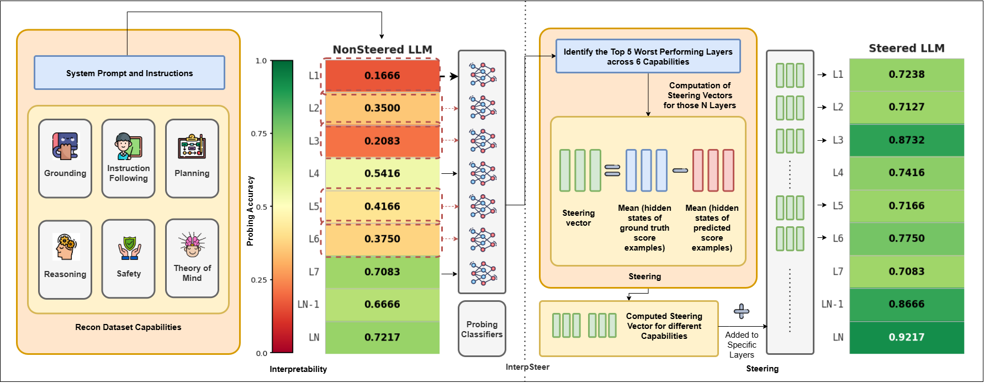
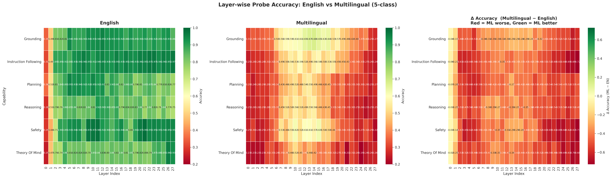
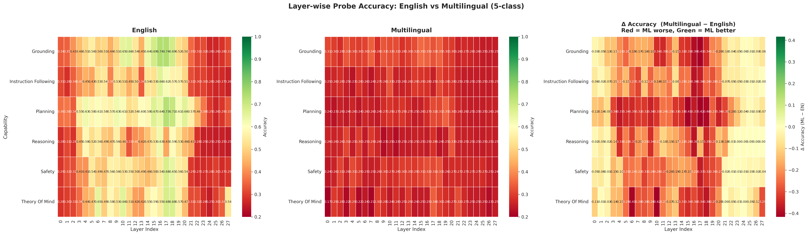
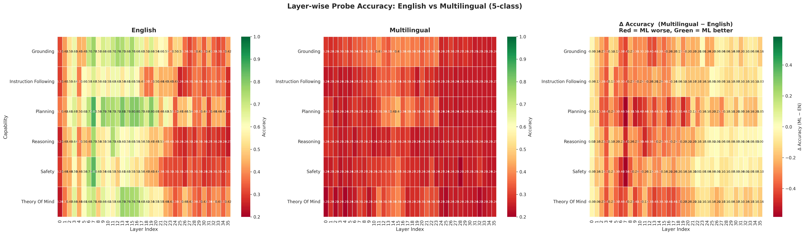

# InterpSteer: Interpreting and Steering Internal Representations in Multilingual Language Models


[](LICENSE)

**Accepted at Findings of EACL 2027 · Athens, Greece.**

**Mihir Panchal · Aakarshit Saxena · Mamta · Deeksha Varshney**

## 🌟 Overview

Multilingual language models often struggle with cross-lingual alignment and reasoning, but identifying where their internal representations fail remains difficult. **InterpSteer** connects interpretation with intervention: it diagnoses response-quality signals across transformer layers and applies activation steering to the layers with the weakest probing performance.

The framework combines:

- **Layer-wise probing:** Train classifiers on hidden states to predict response-quality scores in English and multilingual settings.
- **Capability-specific diagnosis:** Identify representation bottlenecks for grounding, instruction following, planning, reasoning, safety, and theory of mind.
- **Multi-layer activation steering:** Inject normalized, dynamically clamped contrastive vectors during inference, keeping the language model's weights frozen.
- **Forward, reverse, and unified interventions:** Compare steering directions and combine capability vectors through summation or averaging.

## 🏗️ Framework



1. **Prepare the data.** Augment BiGGen Bench with responses at target quality scores, then translate prompts, responses, reference answers, and system prompts into six languages.
2. **Probe internal representations.** Train feedforward probes across layers and generation cutoffs to compare English and multilingual response-quality prediction.
3. **Locate bottlenecks.** Rank layers by probing accuracy for each model, capability, and language condition; select the five lowest-performing layers by default.
4. **Construct steering vectors.** Contrast mean hidden states from high-quality responses and reference answers with those from low-quality responses. Reverse steering flips this direction.
5. **Intervene and evaluate.** Apply vectors at the selected layers and compare generated responses against unsteered baselines and reference answers.

## 🔍 Key Findings

The paper reports substantial cross-lingual degradation in the recoverability of response-quality signals:

| Model | Capability | English probe accuracy | Multilingual probe accuracy | Drop |
| --- | --- | ---: | ---: | ---: |
| BharatGPT-3B-Indic | Reasoning | 91.67% | 55.83% | 35.84 percentage points |
| Tiny Aya Base | Planning | 86.31% | 45.83% | 40.48 percentage points |

- **Intermediate layers carry stronger predictive signals.** Early and late layers frequently show weaker probing performance, with patterns varying across models.
- **Steering direction depends on the model and capability.** BharatGPT-3B-Indic generally favors forward steering; Sarvam-1 favors reverse steering for several capability-specific interventions; Tiny Aya Base shows no aggregate directional preference in the paper's overall comparison.
- **Reasoning and instruction following respond differently.** Forward steering is stronger for reasoning across the evaluated models, while reverse steering is preferred for instruction following.

Probe accuracy measures how well a classifier can recover a quality label from hidden states. Steering gains should be assessed separately for each model and capability; the paper does not establish universal improvements across all interventions.

<details>
<summary><strong>Layer-wise English and multilingual probing results</strong></summary>

**BharatGPT-3B-Indic**



**Sarvam-1**



**Tiny Aya Base**



</details>

## 🗂️ Dataset and Models

The experiments use a six-capability subset of [BiGGen Bench](https://huggingface.co/datasets/prometheus-eval/BiGGen-Bench), a generation benchmark spanning 77 tasks and nine capabilities in its original release. The repository contains **1,927 English samples** and **11,562 translated samples**, with 1,927 samples each in Bengali, German, French, Hindi, Telugu, and Urdu.

| Capability | English samples | Translated samples |
| --- | ---: | ---: |
| Grounding | 400 | 2,400 |
| Instruction following | 400 | 2,400 |
| Planning | 280 | 1,680 |
| Reasoning | 400 | 2,400 |
| Safety | 247 | 1,482 |
| Theory of mind | 200 | 1,200 |
| **Total** | **1,927** | **11,562** |

| File | Contents |
| --- | --- |
| [combined_dataset.csv](data/combined_dataset.csv) | Input records for response generation |
| [combined_dataset_with_responses.csv](data/combined_dataset_with_responses.csv) | English records with generated responses and target scores |
| [biggen_bench_translated.csv](data/biggen_bench_translated.csv) | Translated records with the original English fields and language metadata |

English fields include `capability`, `task`, `system_prompt`, `input`, `reference_answer`, `score_rubric`, `orig_score`, and `orig_response`. Translated records add `orig_index`, `language`, `translated_system_prompt`, `translated_input`, `translated_reference_answer`, and `translated_orig_response`.

**Score configuration:** The released generated responses have target scores **1–4** (482, 482, 482, and 481 English samples, respectively). The commands below therefore use `--num_classes 4 --score_range 1 4`. The code also supports the paper's five-class formulation, but a five-class run requires appropriate labeled data. Reference answers are treated as **score-5 positives** when constructing steering vectors.

| Model evaluated in the paper | Hugging Face identifier |
| --- | --- |
| BharatGPT-3B-Indic | `CoRover/BharatGPT-3B-Indic` |
| Sarvam-1 | `sarvamai/sarvam-1` |
| Tiny Aya Base | `CohereLabs/tiny-aya-base` |

## 🚀 Quick Start

### Installation

Use a Python environment with a CUDA-compatible PyTorch installation and sufficient GPU memory for the selected model. The scripts use FP16 inference and automatic device placement across available GPUs.

```bash
git clone https://github.com/MihirRajeshPanchal/InterpSteer.git
cd InterpSteer

python -m venv .venv
source .venv/bin/activate
python -m pip install torch transformers accelerate numpy pandas scikit-learn tqdm matplotlib seaborn
```

These examples use Bash syntax; on Windows, run them in WSL or adapt them for PowerShell. To activate a native Windows environment in PowerShell, use `.venv\Scripts\Activate.ps1`.

Pass either a Hugging Face model identifier or a local checkpoint directory to `--model_name`. If a checkpoint requires authenticated access, accept its access terms and authenticate with `hf auth login` after installing `huggingface_hub`.

**Local configuration:** Update the hardcoded `offload_folder` in `english_probing.py` and `multilingual_probing.py` to a writable local directory before running. Model loaders also set a **10 GiB per-GPU memory limit**; adjust it for your hardware if needed. The repository does not include a pinned dependency environment or model checkpoints.

### 1. Run English and multilingual probing

The following example probes all layers for reasoning using Sarvam-1:

```bash
python english_probing.py \
  --data_path data/combined_dataset_with_responses.csv \
  --model_name sarvamai/sarvam-1 \
  --all_layers \
  --num_classes 4 --score_range 1 4 \
  --balance_data --use_class_weights \
  --num_epochs 5 --batch_size 2 \
  --filter_capability reasoning \
  --output_dir outputs/sarvam-1/english/tasks/reasoning

python multilingual_probing.py \
  --data_path data/biggen_bench_translated.csv \
  --model_name sarvamai/sarvam-1 \
  --all_layers \
  --num_classes 4 --score_range 1 4 \
  --balance_data --use_class_weights \
  --num_epochs 5 --batch_size 2 \
  --filter_capability reasoning \
  --output_dir outputs/sarvam-1/multilingual/tasks/reasoning
```

Repeat with `grounding`, `instruction_following`, `planning`, `safety`, and `theory_of_mind` to cover all six capabilities, and change `--model_name` and output directories for each model. Use `--layer_idx` instead of `--all_layers` for a single layer. The default generation cutoff is `--percentage 0`; set it explicitly for other cutoffs.

### 2. Analyze bilingual probing results

```bash
python probing_analysis.py \
  --english_dir outputs/sarvam-1/english \
  --multilingual_dir outputs/sarvam-1/multilingual \
  --output_dir outputs/sarvam-1/results \
  --bottom_k 5
```

This produces comparison plots, `bilingual_metrics.csv`, and `bilingual_report.txt`. Steering scripts use these files to select the lowest-performing layers.

### 3. Apply capability-specific steering

```bash
python new_steering_percap.py \
  --data_path data/biggen_bench_translated.csv \
  --model_name sarvamai/sarvam-1 \
  --analysis_dir outputs/sarvam-1/results \
  --condition Multilingual \
  --filter_capability reasoning \
  --top_n_worst 5 --alpha 0.5 --position last \
  --high_score_threshold 5 --low_score_threshold 1 \
  --max_steering_samples 50 --num_eval_samples 50 \
  --max_new_tokens 512 \
  --output_dir outputs/sarvam-1/steering/reasoning
```

The default column arguments select the translated fields. This run saves steering vectors, a results CSV containing baseline and steered generations, and a summary JSON. For reverse steering, use `reverse_new_steering_percap.py` with the same arguments and save to `outputs/sarvam-1/reverse_steering/reasoning`.

For an intensity sweep, use `--mode alpha_search --alpha_values 0.1 0.5 1 2 5 10` with either capability-specific script.

### 4. Combine steering vectors across capabilities

After probing and analyzing **all six capabilities**, run:

```bash
python unified_steering.py \
  --data_path data/biggen_bench_translated.csv \
  --model_name sarvamai/sarvam-1 \
  --analysis_dir outputs/sarvam-1/results \
  --condition Multilingual \
  --combine_mode sum \
  --top_n_worst 5 --alpha 0.5 \
  --max_steering_samples 50 --num_eval_samples 50 \
  --max_new_tokens 512 \
  --output_dir outputs/sarvam-1/steering
```

Use `--combine_mode average` to average vectors at shared layers. For reverse unified steering, use `reverse_unified_steering.py` and save to `outputs/sarvam-1/reverse_steering`. Each script appends `unified_sum/` or `unified_average/` to its output directory.

### 5. Evaluate generated responses

Install the optional text-metric dependencies, then compare saved forward, reverse, and baseline responses:

```bash
python -m pip install rouge-score nltk bert-score evaluate

python reverse_vs_non_steering.py \
  --mode per_model \
  --model_name sarvam-1 \
  --base_storage_dir outputs \
  --output_dir outputs/sarvam-1/nlp_metrics_analysis
```

The evaluator supports ROUGE, BLEU, METEOR, BERTScore, BLEURT, and lexical-diversity analysis, depending on installed packages and available metric resources. BLEURT needs additional setup; unavailable metrics are skipped. Use `--no_network` to disable Hugging Face-dependent metrics; remaining metrics may still require locally installed NLTK resources.

### Optional: Regenerate responses and translations

The released CSV files let you start directly with probing. To rebuild them, `generate_responses.py` uses an Ollama endpoint with `gpt-oss:120b`, and `dataset_translation.py` uses Google Translate through `deep-translator`.

Install `ollama` and `deep-translator` if using these scripts. Configure your own endpoint and credentials in `generate_responses.py`, and update the input and output paths in `dataset_translation.py` before running. Response generation and translation both support resuming from their output CSV files.

## 📁 Project Structure

```text
InterpSteer/
├── README.md
├── LICENSE
├── english_probing.py              # English response-quality probes
├── multilingual_probing.py         # Probes using translated fields
├── probing_analysis.py             # Bilingual comparisons and layer rankings
├── new_steering_percap.py           # Forward capability-specific steering
├── reverse_new_steering_percap.py   # Reverse capability-specific steering
├── unified_steering.py             # Combined forward steering vectors
├── reverse_unified_steering.py     # Combined reverse steering vectors
├── reverse_vs_non_steering.py       # Generation metrics and comparisons
├── generate_responses.py           # Target-score response generation
├── dataset_translation.py          # Multilingual dataset construction
├── bash/                           # Original experiment launch scripts
├── data/                           # English and translated datasets
├── logs/                           # Experiment logs
└── latex/                          # Paper source, architecture, and result figures
```

The launch scripts in `bash/` retain the original cluster paths, `reasoning_probe/` directory prefix, and GPU selections. Adapt these settings to your environment before using the batch launchers. The commands above run from this repository's root.

## 📝 Citation

If you use InterpSteer in your research, please cite our paper. The entry below records the acceptance details; update it with the official proceedings metadata when available.

```bibtex

```

## 📄 License

The code is released under the [MIT License](LICENSE). Upstream datasets and model checkpoints remain subject to their respective licenses and terms.

## 📬 Contact

For questions about this work, contact [Mihir Panchal](mailto:mihir@comp.nus.edu.sg) or open an [issue](https://github.com/MihirRajeshPanchal/InterpSteer/issues).
